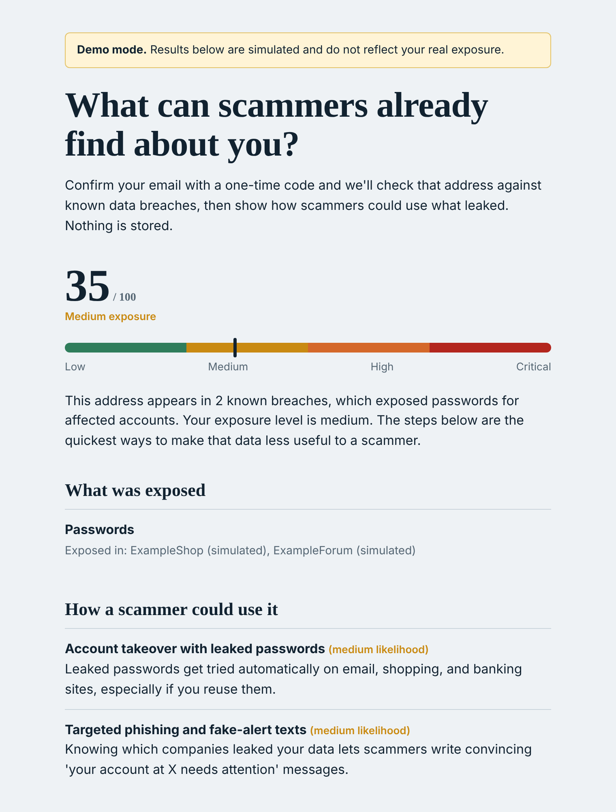

# Exposure Check

A consent-based tool that turns breach data into scam-prevention guidance for the person it belongs to.

**What it is, honestly:** the breach lookup comes from [Have I Been Pwned](https://haveibeenpwned.com), which anyone can already use directly. The value added here is the *interpretation*: mapping what leaked to the specific scam scripts it makes believable, ranking them with an explainable score, and giving a prioritized action list. A concept note on how a bank could use the same signal, with customer consent, is in [`docs/BANK_USE.md`](docs/BANK_USE.md).

**Status:** working prototype. As published, it runs on **simulated breach data**, so results are illustrative and are not anyone's real exposure. Real lookups need a breach-data API key (see Configuration).

**Try it without installing anything:** [demo with three made-up people](https://narendranarukullaeee-ops.github.io/scam-exposure-check/). It uses simulated breach records and needs no sign-up.

**Disclaimer:** personal project. Views are my own and not related to my employer.



## How it works

1. The visitor enters an email and receives a 6-digit one-time code (valid 10 minutes, 5 attempts, single use).
2. Only after the code is verified does the app look up that one address in a breach database.
3. A **deterministic rule engine** (`app/scoring.py`) produces the exposure score, level, scam scenarios and remediation steps. Every point in the score is listed in `factors`, so results are auditable.
4. An LLM (Gemini) is used **only** to rewrite the result as a plain-English summary. It never sees the email, never changes the score, and the app falls back to a template if it is unavailable.
5. Nothing is stored: no emails, codes or results. One-time codes live in memory under an HMAC of the email and expire.

```
email -> OTP (in memory) -> verified? -> breach lookup -> rule-based score -> LLM summary (optional) -> response
```

## Design choices (and why)

| Choice | Reason |
|---|---|
| Verify email ownership before any lookup | Nobody can query someone else's data |
| Rule-based score, LLM only explains | Explainable, testable, consistent; no model judgement on a person's risk |
| No persistence | Nothing to leak or subpoena; simpler privacy story |
| Per-IP and per-email limits, daily caps on emails and LLM calls | Prevents abuse and surprise bills on a public demo |
| Phone guidance without phone lookup | SMS verification is costly and abuse-prone (SMS pumping); breach APIs are email-centric |
| Simulated mode clearly labelled | Runs with no paid key; the UI shows a banner and the API returns `data_source: "simulated"` |

## Demo page

`docs/index.html` is a static page showing the result for three made-up people. `scripts/build_demo.py` generates it from the app's own scoring code and simulated breach records, so the page matches the engine; `tests/test_demo.py` fails if the page is out of date. After changing the scoring rules, run `python scripts/build_demo.py` and commit the new page.

## Run locally

```bash
pip install -r requirements-dev.txt
cp .env.example .env        # optional; defaults run in simulated + console mode
uvicorn app.main:app --reload
pytest
```

In `console` email mode the one-time code is printed to the server log (development only).

## Configuration

See `.env.example`. For a real deployment you need: `APP_SECRET`, a mail provider (`EMAIL_PROVIDER=brevo|resend` + `MAIL_API_KEY` + `MAIL_FROM`), and `HIBP_API_KEY` for real breach data. `GEMINI_API_KEY` is optional. Check each provider's current free-tier and sender-verification rules before launch.

## Deploy (Render)

Connect the repo, choose the Docker runtime (`render.yaml` is included), and set the secrets above. Free instances sleep when idle, so the first request can take up to a minute.

## Data and attribution

Real results come from the Have I Been Pwned API and must credit it; the app shows the attribution on every result. Check HIBP's current terms and pricing before launch. Each breach record describes what that breach contained overall, so results are worded as "exposed in these breaches", not "your data was exposed". Sensitive breaches are not publicly searchable, so a clean result is not a guarantee.

## Tests

`pytest` runs unit tests for scoring, the OTP flow and API behaviour, plus `tests/test_calibration.py`: a small hand-labelled set of profiles with the level and top scam scenario an analyst would expect. It is a sanity check on the weights, not validation against real scam outcomes.

## Limitations

- Breach presence is not the same as current risk; it shows what has leaked, not what is being used.
- Limits are in memory and reset on restart. Use Redis and a CAPTCHA (e.g. Cloudflare Turnstile) before any real traffic.
- Email only. Phone verification is a possible next step once abuse controls are in place.
- Prototype for education. Not affiliated with any employer, bank or breach-data provider.

## Roadmap

CAPTCHA, Redis-backed limits, opt-out links for people-search sites, a small labelled evaluation set for the scoring weights.
